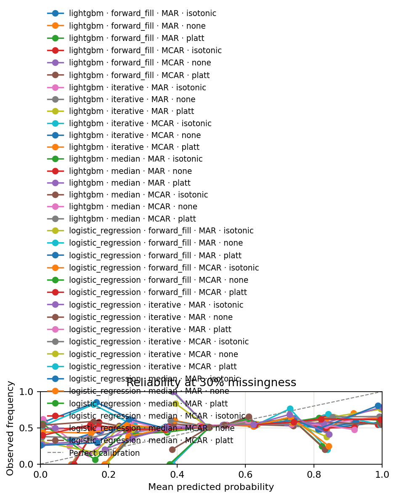

# CalibMiss: Calibrated Return Forecasts Under Missing Data

CalibMiss is an empirical research pipeline evaluating whether probabilistic next-day stock-direction forecasts remain calibrated when feature inputs suffer from missingness. It compares Missing Completely at Random (MCAR) and Missing at Random (MAR) mechanisms across missingness rates, imputers, model families, and post-hoc calibrators using chronological walk-forward splits.

> **Scope notice:** CalibMiss is a calibration research study, not a trading strategy. Profitability analysis, transaction costs, live execution, and position sizing are explicitly outside project scope.

---

## RQ1 Answer: Missingness Degrades Calibration Where Signal Exists

The project's research question — *how does calibration degrade as missingness increases?* — is answerable on the **realized-volatility target**, not next-day direction. The volatility grid (realized 5-day volatility binarized at the training-fold median, 60-day purge; 22 folds × 5 seeds):

- **Signal is real.** Models reach AUC ~0.73 versus persistence 0.67 and naive 0.50, so there is accuracy for missingness to damage.
- **Degradation is measurable and monotone under MCAR.** From 0% to 30% missingness, ECE rises ~0.003 (0.0666 → 0.0700 for LightGBM) and AUC falls ~0.008. The effect is small but consistent in direction across seeds.
- **Mechanism matters less than rate here.** MAR degrades less (nearly flat), consistent with a single-feature dependence on `volume_ratio`.
- **Calibrators do not recover it.** LightGBM's probabilities are already well ranked; Platt adds distortion rather than removing it on this target.

Results in `results/volatility/`; run with `make experiment-volatility` / `make figures-volatility`.

## Key Findings

From the full grids (see `reports/pipeline_run.md` for run logs and exact numbers):

- **The naive base rate is already hard to beat on next-day direction.** Predicting each fold's training up-day frequency scores Brier 0.2489 and ECE 0.0170. The best direction cell (logistic regression, median imputation, Platt scaling) reaches Brier 0.2488 and ROC AUC 0.516 — a difference inside the noise. An AUC near 0.5 is what efficient-market intuition predicts for next-day direction from lag-only price/volume features.

- **Calibration fixes overconfident models; it does not improve predictions.** Uncalibrated LightGBM is the worst-calibrated cell (ECE 0.0407 on complete data); Platt brings it to 0.0194. For logistic regression, Platt improves ECE from 0.0234 to 0.0199 (~15%) while leaving ROC AUC unchanged. (An earlier `class_weight: "balanced"` run inflated these gains; the grid now runs unweighted.) Significant paired tests are ~0.004–0.005 Brier and are almost entirely calibrator contrasts.

- **Missingness is measured, not assumed, on three mechanisms.** The grid now simulates MCAR (cell-by-cell), **MCAR-BLOCK** (whole consecutive-day streaks per ticker — halts, API gaps, delist days), and MAR (conditional on volume ratio), each at 0/10/20/30%, together with a complete-case **drop** baseline alongside forward-fill, median, and MICE (now at `max_iter: 50`, converging). The flat direction curve is a property of the target's lack of signal, while the volatility grid isolates the real missingness effect.



---

## Research Questions

1. How does calibration error (Brier score, Expected Calibration Error) degrade as missingness increases from 0% to 30% under MCAR and MAR?
2. Does calibration degradation differ systematically between MCAR and MAR mechanisms?
3. Can imputation combined with Platt scaling or isotonic regression recover calibration, and what discrimination cost (ROC AUC) does that recovery impose?

---

## Pipeline Architecture

The codebase is organized as a modular Python package under `src/calibmiss/`:

```
src/calibmiss/
├── config.py           # Pydantic schemas and YAML configuration loaders
├── data.py             # yfinance download, Parquet caching with SHA256 checksum, OHLCV validation
├── features.py         # Point-in-time features with lookahead safety (returns, volatility, volume ratio)
├── splits.py           # Walk-forward date-axis splits with chronological purge gaps
├── missingness.py      # MCAR, MCAR-BLOCK (day-streak), and MAR injection (fit on train only)
├── imputers.py         # Causal forward-fill, training-median, MICE, and complete-case drop
├── models.py           # Standardized Logistic Regression and LightGBM probability classifiers
├── calibration.py      # Identity, Platt scaling, and Isotonic regression (fit on cal split only)
├── metrics.py          # Brier score, 10-bin ECE, ROC AUC, and reliability diagram series
├── pipeline.py         # Single (model, imputer, calibrator, mechanism, rate, seed) fold runner
└── run_experiment.py   # Full grid orchestrator, baselines, paired Wilcoxon tests, Holm correction
```

Supporting directories:
- `config/`: YAML specifications (`universe.yaml`, `features.yaml`, `missingness.yaml`, `experiment.yaml`).
- `scripts/`: CLI entry points for pipeline stages (`download_data.py`, `compute_features.py`, `run_grid.py`, `generate_figures.py`).
- `notebooks/`: Diagnostic data exploration (`exploration.ipynb`).
- `reports/`: Complete written report (`report.md`) and non-specialist executive summary (`summary.md`).
- `tests/`: Unit, integration, lookahead safety, and contract test suite.

---

## Setup and Installation

### Prerequisites

- Python 3.11+
- Virtual environment tool (`venv`)
- Standard build tools (`make`)

### Installation

```bash
# Clone the repository
git clone https://github.com/Khairil-12/Calibrated-return-forecasts-under-missing-data.git
cd Calibrated-return-forecasts-under-missing-data

# Create and activate virtual environment
python -m venv .venv
source .venv/bin/activate  # On Windows: .venv\Scripts\activate

# Install dependencies
pip install --upgrade pip
pip install -r requirements.txt
```

---

## Running the Pipeline

The full research pipeline is executable through `make` targets:

```bash
# One-command execution: data -> features -> experiment -> figures -> report
make all
```

### Step-by-Step Execution

1. **Download and cache raw OHLCV data:**
   ```bash
   make data
   # Or: python scripts/download_data.py
   ```
   Downloads 30 large-cap U.S. equities (2010-01-01 to 2024-12-31) from Yahoo Finance, validates OHLCV invariants, and saves to `data/raw/{timestamp}_sha256_{hash}.parquet`.

2. **Compute point-in-time features and target:**
   ```bash
   make features
   # Or: python scripts/compute_features.py
   ```
   Generates 8 lag-only features and next-day direction target into `data/processed/features.parquet` and `target.parquet`.

3. **Run experimental grid:**
   ```bash
   make experiment
   # Or: python scripts/run_grid.py
   ```
   Executes the configured grid across walk-forward folds, writing `results/metrics.csv`, `summary.csv`, `statistical_tests.csv`, and `run_metadata.json`.

4. **Generate figures:**
   ```bash
   make figures
   # Or: python scripts/generate_figures.py
   ```
   Generates line plots (Brier and ECE vs. rate), reliability diagrams at 0% and 30%, and a calibration heatmap in `results/figures/`.

5. **Single configuration test (debugging):**
   ```bash
   make run-single
   # Or: python -m src.calibmiss.run_experiment --model logistic_regression --imputer median --calibrator platt --mechanism MCAR --rate 0.1 --seed 42
   ```

6. **Clean generated artifacts:**
   ```bash
   make clean      # Cleans processed features, metrics, and figures
   make clean-all  # Cleans all generated artifacts including cached raw data
   ```

---

## Experimental Design

| Dimension | Levels |
|---|---|
| **Models** | Logistic Regression (standardized), LightGBM |
| **Imputers** | Forward fill (within-ticker causal), Median (train-only), Iterative/MICE, Drop (complete-case deletion) |
| **Calibrators** | None (identity), Platt scaling, Isotonic regression |
| **Mechanisms** | MCAR (independent feature masking), MCAR-BLOCK (whole-day streaks per ticker), MAR (conditional on volume ratio) |
| **Missing Rates** | 0%, 10%, 20%, 30% |
| **Random Seeds** | 5 seeds per configuration (42, 123, 456, 789, 999) |
| **Splits** | Chronological walk-forward (3-year train, 6-month calibrate, 6-month test, 5-day direction / 60-day volatility purge gap) |
| **Baselines** | Complete-data oracle (0% missingness), Naive training-fold base rate, Volatility persistence (ECDF-rank) |

### Evaluation Metrics

- **Primary:** Brier score (squared probability error), Expected Calibration Error (ECE, 10 equal-width bins), Reliability diagrams.
- **Secondary:** ROC AUC (discrimination).
- **Statistical testing:** Paired Wilcoxon signed-rank tests across walk-forward folds with Holm-Bonferroni correction.

---

## Testing and Code Quality

Run tests, coverage, and linting:

```bash
# Run full test suite
python -m pytest -v

# Run with coverage report
python -m pytest -v --cov=src/calibmiss --cov-report=term-missing

# Lint checks
ruff check .

# Format check
ruff format --check .
```

The test suite enforces:
- Lookahead safety (future raw data mutations cannot alter day $t$ features).
- Leakage prevention (imputers fit on train only; calibrators fit on cal split only).
- Chronological purge enforcement (no overlapping rolling windows).
- Checksum integrity on cached Parquet files.

---

## Limitations and Scope

- Daily equity data for 30 large-cap U.S. stocks; findings may not generalize to intraday frequencies or alternative asset classes.
- The universe was selected from today's large caps and carries survivorship bias: delisted or failed tickers are absent, and current constituents are known with hindsight (META did not trade until May 2012).
- Next-day direction has essentially no predictable signal here (ROC AUC ≈ 0.5), so its missingness-degradation results are uninformative; the realized-volatility target supplies the target with real signal that makes missingness damage measurable.
- Walk-forward folds overlap in time and seeds share the same underlying data, so paired tests treat dependent observations as independent and overstate significance. Effect sizes (~0.005 Brier) matter more than the corrected p-values.
- MCAR-BLOCK, MCAR, and MAR are synthetic simulations designed to test robustness, not full descriptions of live market feed outages; MCAR-BLOCK's streak lengths are drawn uniformly from 2–10 days, a stylized approximation of real gap/halt patterns.
- The drop (complete-case) imputer is not directly comparable to the others at the same 30% rate: it discards the same missing rows as the other imputers cannot use, so its test set differs by design.
- MAR models depend on a single configured trigger variable (`volume_ratio`); sensitivity to other dependencies requires further research.
- Calibration results do not imply economic profitability or alpha generation.
